# ผลการออกแบบและพัฒนาระบบแดชบอร์ดวิเคราะห์ข้อมูลนักท่องเที่ยว (วัดคูหาภิมุข อำเภอเมืองยะลา)

> **หมายเหตุประกอบการจัดทำรายงาน:** เอกสารฉบับนี้จัดทำขึ้นตามโครงสร้างและโค้ดที่พัฒนาจริงในระบบ ณ วันที่จัดทำ เพื่อใช้ประกอบการเขียนบทผลการพัฒนาระบบในรายงานวิจัย ตัวเลขผลการเก็บข้อมูลภาคสนามและผลการประเมินจากผู้เชี่ยวชาญ/ผู้ประกอบการที่ต้องรอข้อมูลจริงทั้งหมดระบุด้วย **`[รอผลจริง]`**

---

## 1. สถาปัตยกรรมระบบ (System Architecture)

ระบบแดชบอร์ดวิเคราะห์ข้อมูลนักท่องเที่ยว ณ วัดคูหาภิมุข (วัดหน้าถ้ำ) อำเภอเมืองยะลา ออกแบบภายใต้สถาปัตยกรรมเว็บแอปพลิเคชันแบบแยกส่วนระหว่าง **ชั้นเก็บและนำเข้าข้อมูล (Data Ingestion & Storage)** กับ **ชั้นประมวลผลและนำเสนอผล (Processing & Presentation Layer)** เพื่อคงรหัส QR Code ของแบบสำรวจ Google Form เดิมที่ใช้งานอยู่ภาคสนามไว้ได้โดยไม่ต้องสร้างฟอร์มใหม่

การไหลของข้อมูลประกอบด้วย 2 ช่องทางหลักเข้าสู่ฐานข้อมูลกลาง **Supabase (PostgreSQL)** ได้แก่ (1) การซิงก์อัตโนมัติทันทีเมื่อผู้ตอบกดส่งแบบฟอร์มผ่าน **Google Apps Script** (`script_googleForm/syncToSupabase.gs`) และ (2) การนำเข้าไฟล์ CSV ที่ส่งออกจาก Google Sheets ผ่านหน้าผู้ดูแลระบบ (`/admin/import` และ `POST /api/admin/import`) จากนั้นระบบ **Next.js (App Router)** จะดึงข้อมูลดิบผ่านโมดูลกลาง `web/lib/survey/*` ทำความสะอาดและคำนวณสถิติตามกติกาเดียวกันทั้งระบบก่อนส่งต่อให้ผู้ใช้งาน 2 บทบาท ได้แก่ **ผู้ประกอบการ/บุคคลทั่วไป (อ่านอย่างเดียว)** และ **ผู้ดูแลระบบ (นำเข้าและตรวจสอบข้อมูล)** ทั้งนี้ในกรณีที่ยังไม่ได้ตั้งค่าตัวแปรสภาพแวดล้อมเชื่อมต่อ Supabase ระบบจะสลับไปใช้ชุดข้อมูลจำลอง 300 แถว (`web/lib/survey/mock.ts`) โดยอัตโนมัติพร้อมแสดงป้าย `"ข้อมูลตัวอย่าง"` เพื่อความต่อเนื่องในการสาธิตและทดสอบ

```mermaid
flowchart LR
    T["นักท่องเที่ยว ณ วัดคูหาภิมุข (สแกน QR)"] --> GF["Google Form (แบบสำรวจเดิม)"]
    GF -->|"onFormSubmit / backfillAll"| GAS["Google Apps Script (syncToSupabase.gs)"]
    GF -->|"บันทึกคำตอบ"| GS["Google Sheets"]
    GS -->|"ดาวน์โหลดไฟล์ .csv"| ADM_UI["หน้าเว็บนำเข้าข้อมูล (/admin/import)"]
    ADM_UI -->|"ตรวจสอบรหัสผ่าน cookie (proxy.ts)"| API["API นำเข้าข้อมูล (/api/admin/import)"]

    GAS -->|"REST API + on_conflict=dedupe_key"| DB[("Supabase PostgreSQL: survey_responses & import_logs")]
    API -->|"SERVICE_ROLE_KEY + upsert dedupe_key"| DB

    DB -->|"getRawRows() ฝั่ง Server"| CORE["แกนคำนวณกลาง (web/lib/survey/*)"]
    MOCK["ข้อมูลจำลอง 300 แถว (กรณีไม่ตั้งค่า env)"] -.->|"Fallback อัตโนมัติ"| CORE

    CORE -->|"อ่านอย่างเดียว (ไม่ต้องเข้าสู่ระบบ)"| VIEWER["ผู้ประกอบการท่องเที่ยว (หน้าวิเคราะห์ 8 หน้า + /guide + /survey-poster)"]
    CORE -->|"ต้องผ่าน ADMIN_PASSCODE"| ADMIN["ผู้ดูแลระบบ (นำเข้า CSV / ตรวจคุณภาพข้อมูล)"]
```

ผลสรุปสถิติจากการเชื่อมต่อข้อมูลภาคสนามจริงในระบบ:
- จำนวนข้อมูลทั้งหมดที่ซิงก์เข้าสู่ฐานข้อมูลจริง: **`[รอผลจริง]`** รายการ
- จำนวนข้อมูลที่ผ่านเกณฑ์ความสมบูรณ์ (`is_complete = true`): **`[รอผลจริง]`** รายการ

---

## 2. การออกแบบฐานข้อมูล (Database Design)

โครงสร้างฐานข้อมูลถูกกำหนดไว้ในไฟล์ `supabase/schema.sql` โดยใช้ระบบจัดการฐานข้อมูลเชิงสัมพันธ์ PostgreSQL บนแพลตฟอร์ม Supabase ประกอบด้วยตารางหลัก 2 ตาราง ได้แก่ `public.survey_responses` สำหรับเก็บคำตอบรายคน และ `public.import_logs` สำหรับบันทึกประวัติการนำเข้าข้อมูล

### 2.1 พจนานุกรมข้อมูลตาราง `public.survey_responses`

| ลำดับ | ชื่อคอลัมน์ | ชนิดข้อมูล | ข้อกำหนด (Constraint) | คำอธิบาย |
|---|---|---|---|---|
| 1 | `id` | `uuid` | `PRIMARY KEY DEFAULT gen_random_uuid()` | รหัสอ้างอิงเฉพาะของแต่ละแถวข้อมูล |
| 2 | `source` | `text` | `NOT NULL CHECK (source IN ('google_form','csv','seed'))` | แหล่งที่มาของข้อมูล (`google_form`, `csv`, หรือ `seed`) |
| 3 | `form_response_id` | `text` | `NULL` | รหัสอ้างอิงคำตอบจาก Google Form (`FormResponse.getId()`) เฉพาะช่องทางฟอร์ม |
| 4 | `submitted_at` | `timestamptz` | `NOT NULL` | วันและเวลาที่ผู้ตอบส่งแบบสำรวจ (ความละเอียดระดับวินาที, มีดัชนีค้นหา `survey_responses_submitted_at_idx`) |
| 5 | `scr01` | `text` | `NULL` | คำตอบคัดกรองข้อที่ 1 (`ใช่` / `ไม่ใช่`) |
| 6 | `scr02` | `text` | `NULL` | คำตอบคัดกรองข้อที่ 2 (`ใช่` / `ไม่ใช่`) |
| 7 | `con01` | `text` | `NULL` | การให้ความยินยอม (`ยินยอม` / `ไม่ยินยอม`) |
| 8 | `sur01` | `text` | `NULL` | ข้อ 1 ช่วงอายุ (ข้อบังคับ) |
| 9 | `sur02` | `text` | `NULL` | ข้อ 2 พื้นที่พำนัก (ข้อบังคับ; รองรับข้อความอิสระจากฟอร์มเดิม) |
| 10 | `sur03` | `text` | `NULL` | ข้อ 3 ผู้ร่วมเดินทาง (ข้อบังคับ; รองรับ "อื่น ๆ") |
| 11 | `sur04` | `text` | `NULL` | ข้อ 4 พาหนะที่ใช้เดินทาง (ข้อบังคับ; รองรับ "อื่น ๆ") |
| 12 | `sur05` | `text` | `NULL` | ข้อ 5 วัตถุประสงค์ในการมาเยือน (ไม่บังคับ) |
| 13 | `sur06` | `text` | `NULL` | ข้อ 6 ช่องทางที่รู้จักสถานที่ (ไม่บังคับ) |
| 14 | `sur07` | `text` | `NULL` | ข้อ 7 ค่าใช้จ่ายโดยประมาณ (ไม่บังคับ) |
| 15 | `sur08` | `text` | `NULL` | ข้อ 8 สินค้าและบริการที่สนใจ (หลายตัวเลือก คั่นด้วย `, `) |
| 16 | `sur09` | `text` | `NULL` | ข้อ 9 ความพึงพอใจต่อสถานที่ (ระดับ 1–5 หรือยังไม่สามารถประเมินได้) |
| 17 | `sur10` | `text` | `NULL` | ข้อ 10 ความตั้งใจกลับมาเยือนอีก (ไม่บังคับ) |
| 18 | `sur11` | `text` | `NULL` | ข้อ 11 ข้อเสนอแนะเพิ่มเติม (ข้อความอิสระ ไม่บังคับ) |
| 19 | `is_complete` | `boolean` | `GENERATED ALWAYS AS (...) STORED` | คอลัมน์คำนวณอัตโนมัติ แสดงความสมบูรณ์ของแถวข้อมูลเพื่อใช้คัดกรองฐานวิเคราะห์ |
| 20 | `dedupe_key` | `text` | `NOT NULL UNIQUE` | แฮช MD5 สำหรับป้องกันการนำเข้าข้อมูลซ้ำจากทั้ง 2 ช่องทาง |
| 21 | `imported_at` | `timestamptz` | `NOT NULL DEFAULT now()` | วันและเวลาที่แถวข้อมูลถูกบันทึกลงฐานข้อมูล |

### 2.2 พจนานุกรมข้อมูลตาราง `public.import_logs`

| ลำดับ | ชื่อคอลัมน์ | ชนิดข้อมูล | ข้อกำหนด (Constraint) | คำอธิบาย |
|---|---|---|---|---|
| 1 | `id` | `uuid` | `PRIMARY KEY DEFAULT gen_random_uuid()` | รหัสอ้างอิงรายการประวัติการนำเข้า |
| 2 | `source` | `text` | `NOT NULL` | ช่องทางที่นำเข้า (เช่น `csv`) |
| 3 | `file_name` | `text` | `NULL` | ชื่อไฟล์ CSV ที่อัปโหลด |
| 4 | `total_rows` | `int` | `NOT NULL DEFAULT 0` | จำนวนแถวข้อมูลทั้งหมดในไฟล์ที่นำเข้า |
| 5 | `inserted` | `int` | `NOT NULL DEFAULT 0` | จำนวนแถวใหม่ที่บันทึกเพิ่มลงฐานข้อมูลได้สำเร็จ |
| 6 | `duplicates` | `int` | `NOT NULL DEFAULT 0` | จำนวนแถวที่ตรวจพบว่าซ้ำและถูกข้ามโดยระบบ |
| 7 | `errors` | `int` | `NOT NULL DEFAULT 0` | จำนวนแถวที่รูปแบบไม่ถูกต้องหรือไม่สามารถอ่านเวลาได้ |
| 8 | `note` | `text` | `NULL` | หมายเหตุเพิ่มเติมกรณีมีแถวผิดพลาดหรือบันทึกไม่สำเร็จบางส่วน |
| 9 | `created_at` | `timestamptz` | `NOT NULL DEFAULT now()` | วันและเวลาที่ทำรายการนำเข้าข้อมูล |

### 2.3 กลไกการป้องกันข้อมูลซ้ำด้วย `dedupe_key`

เนื่องจากระบบรองรับการนำเข้าข้อมูลจาก 2 แหล่งพร้อมกัน (Google Apps Script และไฟล์ CSV จาก Google Sheets) จึงอาจเกิดการส่งซ้ำหรือนำเข้าไฟล์ที่มีข้อมูลเดิมซ้อนทับกัน ระบบจึงป้องกันข้อมูลซ้ำในระดับฐานข้อมูลด้วยฟังก์ชันทริกเกอร์ `public.survey_dedupe_key()` (`trg_survey_dedupe` ทำงาน `BEFORE INSERT OR UPDATE`) ดังนี้
1. **การตัดความละเอียดเวลาให้ตรงกัน:** ทั้ง `syncToSupabase.gs` และตัวแปลงไฟล์ `web/lib/import/csv.ts` จะปรับค่ามิลลิวินาทีของ `submitted_at` เป็น `000` และฐานข้อมูลแปลงเวลาเป็น `epoch` ระดับวินาที (`floor(extract(epoch from new.submitted_at))::bigint`)
2. **การสร้างลายนิ้วมือข้อมูล (`dedupe_key`):** ฐานข้อมูลนำค่าเวลาแบบวินาทีมาเชื่อมต่อด้วยตัวคั่น `|` ร่วมกับคำตอบตั้งแต่ `scr01` ถึง `sur11` ผ่าน `concat_ws('|', ...)` แล้วเข้ารหัสเป็นค่าแฮช `md5(...)`
3. **การละเว้นแถวซ้ำอัตโนมัติ:** กำหนดข้อจำกัด `UNIQUE` บนคอลัมน์ `dedupe_key` ร่วมกับการเขียนข้อมูลแบบ `on_conflict=dedupe_key` พร้อม `Prefer: resolution=ignore-duplicates` ใน Apps Script และ `upsert(..., { onConflict: 'dedupe_key', ignoreDuplicates: true })` ใน API นำเข้า CSV ทำให้แถวซ้ำไม่เกิดข้อผิดพลาดและไม่เพิ่มแถวซ้อนในฐานข้อมูล (อัตราการป้องกันข้อมูลซ้ำในการใช้งานจริง: `[รอผลจริง]`)

---

## 3. ขั้นตอนตรวจสอบความครบถ้วนและทำความสะอาดข้อมูล

ระบบแยกตรรกะการตรวจสอบและการทำความสะอาดข้อมูลออกจากส่วนแสดงผล (UI) โดยรวมศูนย์ไว้ในโมดูล `web/lib/survey/normalize.ts` และ `web/lib/import/csv.ts` เพื่อรับประกันความถูกต้องของตัวเลขทุกหน้าจอ

### 3.1 เงื่อนไขความสมบูรณ์ของข้อมูล (`is_complete`)

ในตาราง `survey_responses` คอลัมน์ `is_complete` คำนวณอัตโนมัติด้วยเงื่อนไข:
$$\text{is\_complete} \iff (\text{scr01} = \text{'ใช่'}) \land (\text{scr02} = \text{'ใช่'}) \land (\text{con01} = \text{'ยินยอม'}) \land (\text{sur01..sur04} \neq \text{NULL})$$

เมื่อระบบดึงข้อมูลผ่าน `normalize(raw)` จะแยกข้อมูลออกเป็น 2 ชุด ได้แก่ `rows` (เฉพาะแถวที่ `is_complete = true` สำหรับใช้วิเคราะห์บนแดชบอร์ดทุกหน้า) และ `all` (ข้อมูลทั้งหมดรวมแถวที่ไม่ผ่านคัดกรอง ไม่ยินยอม หรือขาดข้อบังคับ สำหรับนำไปตรวจสอบคุณภาพข้อมูลในฟังก์ชัน `quality(all)`)

### 3.2 กฎการทำความสะอาดและแปลงข้อมูลมาตรฐาน

1. **การปรับมาตรฐานข้อความและเครื่องหมายขีด (Dash Normalization):** ตัดช่องว่างหัว–ท้าย (`trim`), แปลงสตริงว่างเป็น `null`, และปรับเครื่องหมายยัติภังค์หรือขีดยาว (`-`, `—`) ระหว่างตัวเลขให้เป็น en dash (`–`, U+2013) เพื่อให้ช่วงอายุ (เช่น `18–24 ปี`) และช่วงค่าใช้จ่าย (เช่น `301–600 บาท`) ตรงกับตัวเลือกมาตรฐานใน `schema.ts`
2. **การแปลงเขตเวลาและปีพุทธศักราช:** แปลงวันเวลาเป็นเขตเวลาไทย (`Asia/Bangkok`, UTC+7) พร้อมรองรับปี พ.ศ. ในไฟล์ CSV (`y > 2400` ลบ `543`) และจัดกลุ่มช่วงเวลาการส่งแบบสำรวจเป็น 4 ช่วง ได้แก่ `เช้า` (06:00–11:59 น.), `บ่าย` (12:00–15:59 น.), `เย็น` (16:00–19:59 น.) และ `อื่น`
3. **การจัดกลุ่มคำตอบอิสระ ("อื่น ๆ"):** ค่าใดที่ไม่อยู่ในรายการตัวเลือกมาตรฐานใน `QUESTIONS[code].choices` จะถูกจัดเข้ากลุ่ม `"อื่น ๆ"` ในการคำนวณความถี่และตารางไขว้ ขณะเดียวกันยังคงข้อความดิบไว้แสดงประกอบใต้กราฟของข้อนั้น ๆ
4. **การจัดการข้อเลือกได้หลายคำตอบและข้อมูลขัดแย้ง (`sur08`):** แยกคำตอบด้วย `, ` และตัดค่าซ้ำ; หากผู้ตอบเลือก `"ไม่มีความสนใจเป็นพิเศษ"` ร่วมกับสินค้า/บริการอื่น ระบบจะตัด `"ไม่มีความสนใจเป็นพิเศษ"` ออกเพื่อให้นับสินค้าที่เลือกจริง และบันทึกสถานะ `sur08conflict = true` เพื่อนับจำนวนข้อมูลขัดแย้ง
5. **การแยกค่า "ไม่ตอบ" กับ "ไม่ประสงค์ระบุ" และการคิดคะแนนความพึงพอใจ (`sur09`):**
   - ค่า `null` / ว่าง นับเป็น **"ไม่ตอบ (ข้าม)"** และไม่นำไปรวมในตัวหาร `base` ของข้อนั้น
   - คำตอบ `"ไม่ประสงค์ระบุ"` และ `"ยังไม่สามารถประเมินได้"` นับเป็นส่วนหนึ่งของผู้ตอบ (`base`) แต่แสดงจำนวนแยกไว้เสมอ
   - สำหรับข้อ 9 ระบบดึงเลขคะแนน `1–5` เข้าฟิลด์ `sat` เพื่อหาค่าเฉลี่ย (`Mean`) และส่วนเบี่ยงเบนมาตรฐานตัวอย่าง (`SD` ด้วยตัวหาร $n-1$) โดยแยก `"ยังไม่สามารถประเมินได้"` ออกจากการคำนวณค่าเฉลี่ย และแปลผลตาม 5 ระดับ ได้แก่ `4.21–5.00` (มากที่สุด), `3.41–4.20` (มาก), `2.61–3.40` (ปานกลาง), `1.81–2.60` (น้อย) และ `1.00–1.80` (น้อยที่สุด)
   - กำหนดการปัดทศนิยม: ร้อยละ 1 ตำแหน่ง, ค่าเฉลี่ย/SD 2 ตำแหน่ง, แจ้งเตือนเมื่อกลุ่มตัวอย่างน้อยกว่า 5 คน (`SMALL_N = 5`), และแสดงข้อความกำกับขอบเขตการเลือกตัวอย่างแบบสะดวกทุกหน้า

---

## 4. โครงสร้างเมนูและหน้าจอ (Menu & Screen Structure)

ระบบแบ่งหน้าจอออกเป็นกลุ่มหน้าวิเคราะห์สำหรับผู้ประกอบการภายใต้ route group `web/app/(dash)/` (มีแถบตัวกรองรวม 5 มิติ ได้แก่ ช่วงวันที่, ช่วงอายุ, พื้นที่พำนัก, ผู้ร่วมเดินทาง และพาหนะ ซิงก์ผ่าน URL query ทุกหน้า), หน้าเผยแพร่อิสระนอกกลุ่มแดชบอร์ด และกลุ่มหน้าผู้ดูแลระบบ

| ลำดับ | เส้นทาง / เมนู | ตัวชี้วัด / องค์ประกอบหลักบนหน้าจอ | รหัสข้ออ้างอิง | ประโยชน์ต่อผู้ประกอบการ |
|---|---|---|---|---|
| 1 | `/` (**ภาพรวม**) | KPI 5 ตัว (ผู้ตอบเทียบเป้า 267/300, พึงพอใจเฉลี่ย, % กลับมาอีก, ค่าใช้จ่ายหลัก, สินค้าสนใจอันดับ 1), กราฟรายวัน, กราฟช่วงเวลา, ข้อค้นพบ 3 ข้อ | `SUR-01`–`SUR-10`, `submitted_at` | เห็นภาพรวมกำลังซื้อ ช่วงเวลาหนาแน่น และแนวโน้มสำคัญได้ภายใน 30 วินาที |
| 2 | `/visitors` (**ผู้ตอบแบบสำรวจ**) | กราฟแท่งแนวนอนเรียงมาก→น้อย พร้อมคำตอบ "อื่น ๆ" และตารางข้อมูลสลับดูได้ | `SUR-01` (อายุ), `SUR-02` (พื้นที่พำนัก) | แยกกลุ่มลูกค้าในจังหวัดกับต่างพื้นที่ เพื่อปรับภาษาสื่อสารและสินค้าให้เหมาะกับวัย |
| 3 | `/travel` (**การเดินทาง**) | กราฟผู้ร่วมเดินทาง, กราฟพาหนะ, ตารางไขว้ heatmap `SUR-03 × SUR-04` | `SUR-03` (มากับใคร), `SUR-04` (พาหนะ) | วางแผนพื้นที่จอดรถ ขนาดโต๊ะอาหาร/ห้องพัก และโอกาสจัดรถรับ-ส่ง |
| 4 | `/awareness` (**วัตถุประสงค์ & ช่องทางรับรู้**) | กราฟวัตถุประสงค์การมาเยือน, กราฟช่องทางรับรู้สถานที่ | `SUR-05` (วัตถุประสงค์), `SUR-06` (ช่องทาง) | เลือกช่องทางประชาสัมพันธ์/ยิงโฆษณา และเล่าเรื่องสินค้าให้ตรงเหตุผลที่มา |
| 5 | `/spending` (**ค่าใช้จ่าย & ความสนใจ**) | กราฟช่วงค่าใช้จ่าย, กราฟความสนใจหลายคำตอบ (% > 100 ได้), ตารางไขว้ `SUR-07 × SUR-08` | `SUR-07` (ค่าใช้จ่าย), `SUR-08` (สินค้า/บริการ) | กำหนดราคาขายและจัดชุดสินค้า/บริการให้สอดคล้องกับงบประมาณลูกค้า |
| 6 | `/satisfaction` (**ความพึงพอใจ & ข้อเสนอแนะ**) | กราฟกระจายคะแนน 1–5, Mean/SD/แปลผล, กราฟกลับมาเยือน, รายการการ์ดข้อเสนอแนะพร้อมช่องค้นหาคำ | `SUR-09` (พึงพอใจ), `SUR-10` (กลับมา), `SUR-11` (ข้อเสนอแนะ) | รับรู้จุดแข็ง/จุดที่ควรปรับปรุงของพื้นที่และเสียงสะท้อนจริงจากนักท่องเที่ยว |
| 7 | `/business` (**มุมมองตามประเภทธุรกิจ**) | ปุ่มเลือก 4 กลุ่มธุรกิจ (ร้านอาหาร, ที่พัก, ของฝาก, นำเที่ยว) พร้อม KPI เฉพาะทางและกฎข้อแนะนำพร้อมตัวเลขหลักฐาน | `SUR-02`–`SUR-08`, `slot` | อ่านข้อเสนอเบื้องต้นที่คัดเฉพาะประเด็นที่เกี่ยวข้องกับกิจการของตนโดยตรง |
| 8 | `/reports` (**รายงาน & ส่งออก**) | ตารางความถี่และร้อยละครบทุกข้อ (`SUR-01`–`SUR-10`), รายการ `SUR-11`, ปุ่มส่งออก CSV (UTF-8 BOM), ปุ่มพิมพ์/PDF (A4) | `SUR-01`–`SUR-11` | นำตัวเลขไปเปิดใน Excel ภาษาไทยหรือพิมพ์เอกสารประชุม/รายงานได้ทันที |
| 9 | `/guide` (**คู่มือผู้ประกอบการ**) | คำอธิบายฐาน `n`, ไม่ตอบ vs ไม่ประสงค์ระบุ, % > 100, ตัวอย่าง "ถ้าเห็น… → ลองทำ…" 4 ธุรกิจ, ข้อจำกัด, FAQ 5 ข้อ | `DATA_CONTRACT` §3–5 | ช่วยเจ้าของร้านที่ไม่ใช่สายไอทีเข้าใจและตีความสถิติบนแดชบอร์ดได้ถูกต้อง |
| 10 | `/survey-poster` (**โปสเตอร์สำรวจ QR**) | โปสเตอร์ขนาด A4 แนวตั้งพร้อม QR Code ขนาดใหญ่เชื่อมไปยัง Google Form และคำชี้แจงสิทธิ์ผู้ตอบ (ไม่มี sidebar) | `NEXT_PUBLIC_SURVEY_URL` | ใช้พิมพ์ติดจุดบริการรอบวัดคูหาภิมุขเพื่อเชิญชวนนักท่องเที่ยวตอบแบบสำรวจ |
| 11 | `/admin/login` และ `/admin/import` (**ส่วนผู้ดูแลระบบ**) | ฟอร์มรหัสผ่านผู้ดูแล, ลากวางไฟล์ CSV จาก Google Sheets, ตรวจ preview/errors, ยืนยันนำเข้าพร้อมสรุปเพิ่มใหม่/ซ้ำ/ผิดพลาด | `SCR-01`–`02`, `CON-01`, `SUR-01`–`11` | สำรองข้อมูลและนำเข้าไฟล์ย้อนหลังเข้าสู่ฐานข้อมูลโดยไม่เกิดข้อมูลซ้ำ *(หมายเหตุ: หน้า `/admin/quality` อยู่ในแผนงาน T3 ตาม `DATA_CONTRACT.md` โดยฟังก์ชัน `quality(all)` พร้อมใช้งานในแกนระบบแล้ว)* |

ผลการทดสอบการใช้งานหน้าจอจริงกับผู้ประกอบการ: **`[รอผลจริง]`**

---

## 5. การกำหนดสิทธิ์ผู้ใช้ (Access Control & Roles)

ระบบออกแบบการควบคุมสิทธิ์แบบแยกบทบาทโดยไม่สร้างระบบบัญชีผู้ใช้ที่ซับซ้อน (สอดคล้องกับเกณฑ์ `EXP-09` และนโยบายไม่เก็บข้อมูลส่วนบุคคล) ดังนี้

| บทบาทผู้ใช้ | ขอบเขตการเข้าถึง | กลไกการยืนยันตัวตนและความปลอดภัย |
|---|---|---|
| **ผู้ประกอบการ / บุคคลทั่วไป (Viewer)** | เข้าถึงหน้าวิเคราะห์ข้อมูลทั้งหมด (`/` ถึง `/reports`), หน้าคู่มือ (`/guide`) และหน้าโปสเตอร์ (`/survey-poster`) แบบอ่านอย่างเดียว | ไม่ต้องเข้าสู่ระบบ, ไม่มีฟอร์มแก้ไขข้อมูล, ฐานข้อมูลจำกัดสิทธิ์อ่าน `SELECT` ผ่าน Supabase RLS (`anon read`) และไม่จัดเก็บข้อมูลระบุตัวตน (ชื่อ/เบอร์โทร/อีเมล) |
| **ผู้ดูแลระบบ (Admin)** | เข้าถึงเส้นทาง `/admin/*` และ API `/api/admin/*` เพื่อนำเข้าข้อมูล CSV และจัดการระบบ | ตรวจสอบสิทธิ์ที่ชั้น Middleware/Proxy (`web/proxy.ts`) และตรวจสอบซ้ำใน API Route (`POST /api/admin/import`): ต้องกรอก `ADMIN_PASSCODE` ใน `/admin/login` → ตรวจสอบด้วยแฮช `SHA-256` แบบ `crypto.timingSafeEqual` → ออก cookie `admin_auth` ชนิด `httpOnly`, `sameSite: 'lax'`, อายุ 12 ชั่วโมง; การเขียนข้อมูลลง Supabase ใช้ `SUPABASE_SERVICE_ROLE_KEY` ฝั่ง server เท่านั้น (`import 'server-only'`) และหากไม่ได้ตั้งค่า env ฐานข้อมูล API จะคืนสถานะ `503` พร้อมข้อความภาษาไทย |

---

## 6. เทคโนโลยีที่ใช้พัฒนา (Technology Stack)

| หมวดหมู่ | เทคโนโลยี / แพ็กเกจ | เวอร์ชัน / รายละเอียด (จาก `web/package.json` และโครงสร้างระบบ) | บทบาทหน้าที่ในระบบ |
|---|---|---|---|
| **Framework & Routing** | Next.js (App Router + Turbopack) | `16.4.6` (`cacheComponents`, `partialPrefetching`) | จัดการเส้นทาง Server/Client Components, streaming `<Suspense>` และ Middleware (`proxy.ts`) |
| **UI Library & Language** | React / TypeScript | React `19.3.0`, TypeScript `^5` (`strict: true`) | พัฒนาส่วนติดต่อผู้ใช้แบบกำหนดชนิดข้อมูลปลอดภัย (Type-safe) |
| **Styling & Typography** | Tailwind CSS v4 + Noto Sans Thai | `4.3.3` (`@tailwindcss/turbopack`), `next/font/google` | ระบบ Design Tokens (Warm Stone / Deep Teal / Amber), Light/Dark Mode, `tabular-nums` และ Print CSS (A4) |
| **Data Visualization** | Recharts & Lucide React | Recharts `^3.10.1`, Lucide React `^1.73.0` | สร้างกราฟแท่งแนวนอน, กราฟพื้นที่รายวัน, และไอคอนระบบ |
| **Database & Client** | Supabase (PostgreSQL) & `@supabase/supabase-js` | `^2.119.0` | จัดเก็บข้อมูลคำตอบและประวัติการนำเข้า พร้อม RLS, `is_complete` และ `dedupe_key` trigger |
| **Data Ingestion & Export** | Google Apps Script, PapaParse, `qrcode.react` | PapaParse `^5.7.1`, `qrcode.react` `^4.2.0` | ซิงก์คำตอบอัตโนมัติจาก Google Form, แปลงไฟล์ CSV จาก Google Sheets และสร้าง QR Code โปสเตอร์ |
| **Testing & Quality** | Vitest & ESLint | Vitest `^5.1.0`, ESLint `^9` (`eslint-config-next`) | ทดสอบหน่วยฟังก์ชันคำนวณสถิติและตัวแปลง CSV อัตโนมัติ และตรวจมาตรฐานโค้ด |
| **Hosting & Deployment** | Vercel (แผน Deploy ตาม `PLAN.md`) | Root directory: `web/` | เผยแพร่เว็บแอปพลิเคชัน *(สถานะการเผยแพร่จริง: `[รอผลจริง]`)* |

---

## 7. ตารางเทียบเกณฑ์ตรวจประเมินคุณภาพระบบ `EXP-01` ถึง `EXP-11` กับฟีเจอร์ของระบบ

อ้างอิงรายการประเมินคุณภาพระบบสำหรับผู้เชี่ยวชาญจากเครื่องมือวิจัย (`EXP-01` ถึง `EXP-11` ในเอกสาร IOC; ทั้งนี้แบบประเมินฉบับจริงมีข้อ `EXP-12` ด้านการตอบโจทย์ตัดสินใจเพิ่มเติมด้วย)

| รหัส | รายการประเมินตามเกณฑ์ผู้เชี่ยวชาญ | ฟีเจอร์และกลไกที่พัฒนาเพื่อรองรับ | ส่วนอ้างอิงในระบบ | ผลการตรวจประเมิน |
|---|---|---|---|---|
| **EXP-01** | ข้อมูลที่นำเข้าและข้อมูลที่แสดงบนระบบแดชบอร์ดตรงกับชุดข้อมูลต้นทางที่ใช้ตรวจสอบ | ซิงก์ตรงจาก Google Form ผ่าน `syncToSupabase.gs` และนำเข้า CSV ที่แมปหัวคอลัมน์ตรงกับแบบสำรวจใน `csv.ts` พร้อมหน้า preview 10 แถวก่อนบันทึก | `script_googleForm/syncToSupabase.gs`, `web/lib/import/csv.ts`, `/admin/import` | `[รอผลจริง]` |
| **EXP-02** | ระบบตรวจสอบหรือป้องกันข้อมูลซ้ำและข้อผิดพลาดในการนำเข้าข้อมูลตามข้อกำหนด | ป้องกันข้อมูลซ้ำด้วยคอลัมน์แฮช `dedupe_key` (MD5) ระดับฐานข้อมูล, โหมด `preview` แจ้งบรรทัดผิดพลาดก่อน commit, บันทึกตาราง `import_logs`, และตรวจจับความขัดแย้ง `sur08conflict` | `supabase/schema.sql`, `/api/admin/import`, `/admin/import`, `normalize.ts` | `[รอผลจริง]` |
| **EXP-03** | ระบบแสดงจำนวนผู้ตอบ ขอบเขตข้อมูล และรายการที่ขาดข้อมูลได้ถูกต้องชัดเจน | คอมโพเนนต์ `ChartCard` แสดง `"ฐาน n = X คน · ไม่ตอบ Y คน · ไม่ประสงค์ระบุ Z คน"` ทุกกราฟ, `DashPageHeader` แสดงจำนวนที่กรองเทียบทั้งหมด, และ `quality(all)` สรุปข้อมูลขาดรายข้อ | `web/components/ChartCard.tsx`, `DashPageHeader.tsx`, `aggregate.ts` | `[รอผลจริง]` |
| **EXP-04** | จำนวนและร้อยละที่ระบบแดชบอร์ดคำนวณตรงกับค่าที่ตรวจสอบจากข้อมูลต้นทาง | รวมศูนย์การคำนวณทั้งหมดใน `web/lib/survey/aggregate.ts` (`freq`, `multiFreq`, `satisfaction`, `crosstab`) ปัด % 1 ตำแหน่ง, Mean/SD 2 ตำแหน่ง และมี unit test ตรวจสอบ | `web/lib/survey/aggregate.ts`, `web/tests/*.test.ts` | `[รอผลจริง]` |
| **EXP-05** | เมื่อใช้ตัวกรองข้อมูล ผลรวม ตัวเลขสรุป ตาราง และกราฟปรับเปลี่ยนสอดคล้องกัน | แถบตัวกรองรวม 5 มิติ (`FilterBar`) ซิงก์ URL query ผ่าน `filtersFromSearchParams` / `filtersToQuery` และทุกหน้าคำนวณ KPI กราฟ ตารางไขว้ และผลส่งออก CSV ใหม่จาก `applyFilters(rows, filters)` ชุดเดียวกัน | `web/components/FilterBar.tsx`, `useFilteredRows.ts`, `web/lib/survey/filters.ts` | `[รอผลจริง]` |
| **EXP-06** | ชื่อกราฟ ป้ายกำกับ หน่วยนับ และฐานจำนวนที่ใช้คำนวณร้อยละถูกต้องและไม่ชวนตีความผิด | กำหนดชื่อข้อตรงตาม `DATA_CONTRACT`, แสดง label บนแท่งเป็น `"count (pct%)"`, มีป้ายกำกับกรณี `sur08` รวม > 100% ได้, แยกป้ายความพึงพอใจต่อสถานที่ และปุ่มสลับดูเป็นตาราง | `FreqBar.tsx`, `SatisfactionChart.tsx`, `ChartCard.tsx`, `schema.ts` | `[รอผลจริง]` |
| **EXP-07** | เมนู การนำทาง และตัวกรองทำงานได้ตามข้อกำหนดบนหน้าจออุปกรณ์ที่รองรับ | ออกแบบ Responsive รองรับมือถือ (Drawer + Bottom Nav + ตัวกรองย่อ/ขยายได้) จนถึงเดสก์ท็อป (Sidebar + Sticky Filter Bar) พร้อม Light/Dark Mode | `DashShell.tsx`, `FilterBar.tsx`, `globals.css` | `[รอผลจริง]` |
| **EXP-08** | เมื่อไม่มีข้อมูลหรือเกิดข้อผิดพลาด ระบบแสดงสถานะและข้อความแจ้งอย่างเหมาะสม | แสดง `EmptyState` พร้อมเหตุผลและปุ่มล้างตัวกรองเมื่อผลกรองเป็น 0, แสดง `SmallSampleBadge` เตือนเมื่อ `n < 5`, มี `error.tsx` / `loading.tsx` ภาษาไทย และ fallback mock เมื่อ DB ขัดข้อง | `EmptyState.tsx`, `SmallSampleBadge.tsx`, `(dash)/error.tsx`, `data.ts` | `[รอผลจริง]` |
| **EXP-09** | การกำหนดสิทธิ์ใช้งานและการเข้าถึงข้อมูลเป็นไปตามบทบาทผู้ใช้ที่กำหนด | หน้าวิเคราะห์เปิดอ่านอย่างเดียวไม่ต้องล็อกอิน ส่วน `/admin/*` และ `/api/admin/*` ป้องกันด้วย `proxy.ts` + cookie `httpOnly` จาก `ADMIN_PASSCODE` และเขียน DB ด้วย `SERVICE_ROLE_KEY` ฝั่ง server เท่านั้น | `web/proxy.ts`, `web/lib/import/auth.ts`, `supabaseAdmin.ts` | `[รอผลจริง]` |
| **EXP-10** | ข้อมูลและตัวชี้วัดหลักที่แสดงสอดคล้องกับความต้องการซึ่งกำหนดไว้สำหรับระบบ | แสดงตัวชี้วัดครบตามตารางที่ 6 ของรายงานครอบคลุม 8 หน้าวิเคราะห์ (`/`, `/visitors`, `/travel`, `/awareness`, `/spending`, `/satisfaction`, `/business`, `/reports`) พร้อมมุมมองเฉพาะ 4 ประเภทธุรกิจ | `web/app/(dash)/**`, `web/lib/survey/insights.ts` | `[รอผลจริง]` |
| **EXP-11** | ระบบแยกข้อมูลผู้ตอบแบบสำรวจออกจากยอดนักท่องเที่ยวทั้งหมดโดยไม่สรุปเกินขอบเขตข้อมูล | แสดงข้อความ `DISCLAIMER` ประจำทุกหน้าว่า *"ผลนี้สรุปจากผู้ตอบแบบสำรวจ ณ วัดคูหาภิมุข (เลือกตัวอย่างแบบสะดวก) ไม่ใช่ยอดนักท่องเที่ยวทั้งหมด"* พร้อมป้าย `"ข้อเสนอเบื้องต้นจากข้อมูลผู้ตอบ"` และคู่มือ `/guide` | `Disclaimer.tsx`, `InsightCard.tsx`, `(dash)/guide/page.tsx` | `[รอผลจริง]` |

> **หมายเหตุเพิ่มเติมสำหรับแบบประเมินฉบับจริง:** รายการ `EXP-12` (*ผู้เชี่ยวชาญสามารถใช้ข้อมูลบนระบบตอบโจทย์ตัวอย่างการตัดสินใจได้ถูกต้องและแปลผลไม่คลาดเคลื่อน*) รองรับด้วยหน้า `/business`, `/spending` (ตารางไขว้), `/guide` และระบบส่งออก `/reports` โดยมีผลการประเมินอยู่ที่ **`[รอผลจริง]`**
