# ภาคผนวก: คู่มือการใช้งานระบบแดชบอร์ดวิเคราะห์ข้อมูลนักท่องเที่ยว (วัดคูหาภิมุข อำเภอเมืองยะลา)

> **ขอบเขตเอกสาร:** คู่มือฉบับนี้จัดทำขึ้นสำหรับแนบเป็นภาคผนวกในรายงานวิจัย แบ่งเนื้อหาออกเป็น **2 ส่วน** ตามบทบาทผู้ใช้งาน ได้แก่ **(1) คู่มือสำหรับผู้ประกอบการท่องเที่ยวและบุคคลทั่วไป (Viewer)** และ **(2) คู่มือสำหรับผู้ดูแลระบบ (Administrator)**  
> **หมายเหตุภาพประกอบ:** ตำแหน่งที่ระบุ `[ภาพที่ X: ...]` เป็นจุดสำหรับวางภาพหน้าจอจริงภายหลังการปรับปรุงส่วนติดต่อผู้ใช้เสร็จสมบูรณ์

---

## ส่วนที่ 1: คู่มือสำหรับผู้ประกอบการท่องเที่ยวและบุคคลทั่วไป

ผู้ประกอบการร้านอาหาร ที่พัก ร้านของฝาก บริการนำเที่ยว รวมถึงบุคคลทั่วไป สามารถเข้าใช้งานระบบแดชบอร์ดในลักษณะ **อ่านและวิเคราะห์ข้อมูลอย่างเดียว (Read-only)** ได้ทันทีโดยไม่จำเป็นต้องสมัครสมาชิกหรือกรอกรหัสผ่าน ทั้งนี้ระบบไม่จัดเก็บข้อมูลส่วนบุคคลของผู้เข้าชมแต่อย่างใด

### 1.1 การเข้าใช้งานระบบและการสังเกตสถานะหน้าจอ

1. เปิดเว็บเบราว์เซอร์บนเครื่องคอมพิวเตอร์ แท็บเล็ต หรือสมาร์ตโฟน แล้วเข้าสู่ URL ของระบบแดชบอร์ด
2. ระบบรองรับการแสดงผลทั้งหน้าจอขนาดใหญ่ (แถบเมนูด้านข้างซ้าย) และหน้าจอโทรศัพท์มือถือ (ปุ่มเปิดเมนูแบบลิ้นชักมุมซ้ายบนและแถบเมนูด่วนด้านล่าง)
3. ที่ส่วนหัวของทุกหน้าจะแสดงองค์ประกอบสำคัญ 4 ส่วน ได้แก่
   - **แหล่งข้อมูลและเวลาอัปเดตล่าสุด:** แสดงว่าข้อมูลกำลังอ่านจากฐานข้อมูลจริง (**Supabase**) หรือ **ข้อมูลตัวอย่าง** (ในกรณีที่ยังไม่เชื่อมต่อฐานข้อมูล ระบบจะแสดงข้อมูลจำลอง 300 รายการ พร้อมแถบแจ้งเตือน `"ข้อมูลตัวอย่าง"` อย่างชัดเจน)
   - **ลิงก์เว็บหลัก:** เชื่อมต่อไปยังเว็บไซต์หลักของโครงการ (`NEXT_PUBLIC_MAIN_SITE_URL`)
   - **ลิงก์แบบสำรวจ:** เปิดหน้าแบบสำรวจ Google Form ที่ใช้เก็บข้อมูลภาคสนาม (`NEXT_PUBLIC_SURVEY_URL`)
   - **ปุ่มสลับโหมดแสดงผล:** เปลี่ยนธีมหน้าจอระหว่างโหมดสว่าง (Light Mode) และโหมดมืด (Dark Mode)

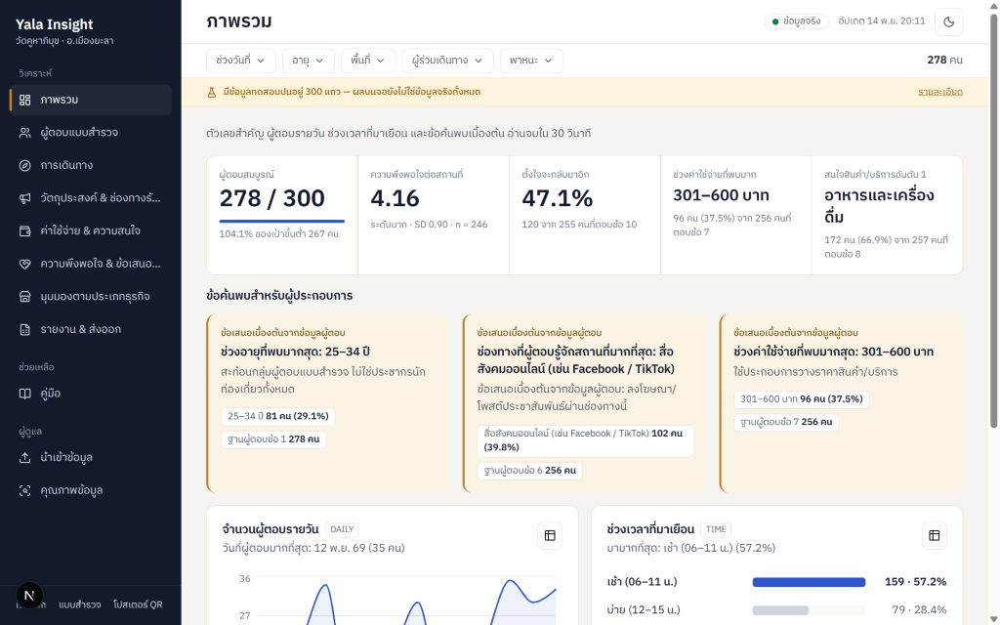

*ภาพที่ ข-1 (ก) หน้าภาพรวม (เดสก์ท็อป) — ภาพประกอบจากข้อมูลทดสอบ*

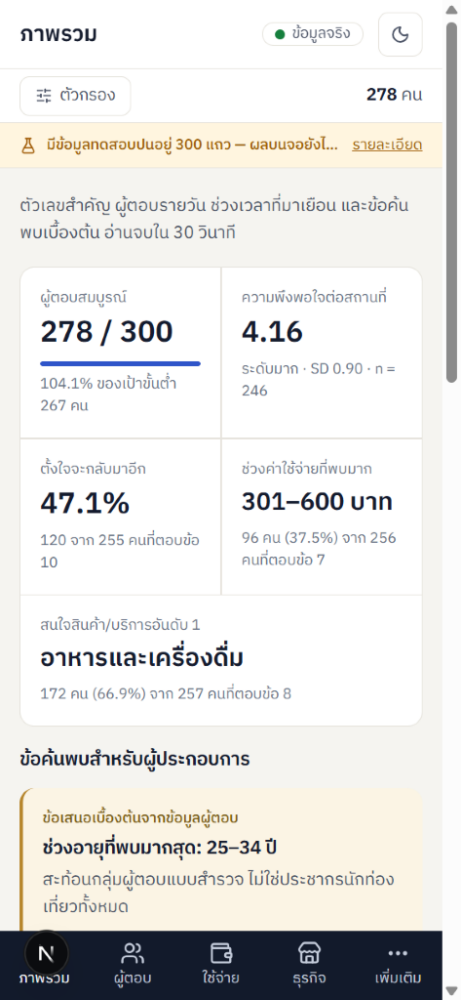

*ภาพที่ ข-1 (ข) หน้าภาพรวม (มือถือ) — ภาพประกอบจากข้อมูลทดสอบ*

> **หน้าเสริมสำหรับผู้ใช้งานทั่วไป**
> - **`/guide` (คู่มือ):** คู่มือการใช้งานฉบับย่อบนหน้าเว็บ พร้อมตัวอย่างการตัดสินใจ "ถ้าเห็น… → ลองทำ…" สำหรับผู้ประกอบการ 4 ประเภท และคำถามที่พบบ่อย (FAQ)
> - **`/survey-poster` (โปสเตอร์ QR):** หน้าโปสเตอร์ขนาด A4 แนวตั้งสำหรับกดพิมพ์นำไปติดประชาสัมพันธ์ ณ จุดบริการหรือรอบวัดคูหาภิมุข เพื่อให้ลูกค้าสแกน QR Code ตอบแบบสำรวจเดิมได้ทันที

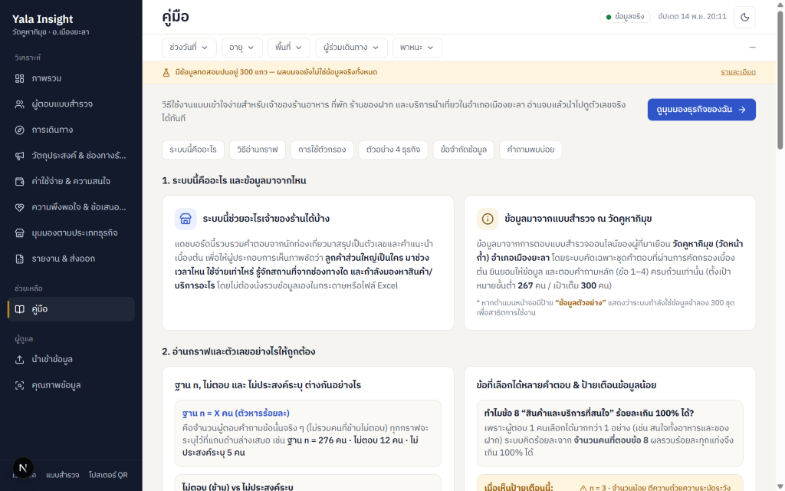

*ภาพที่ ข-2 (ก) หน้าคู่มือผู้ประกอบการ — ภาพประกอบจากข้อมูลทดสอบ*

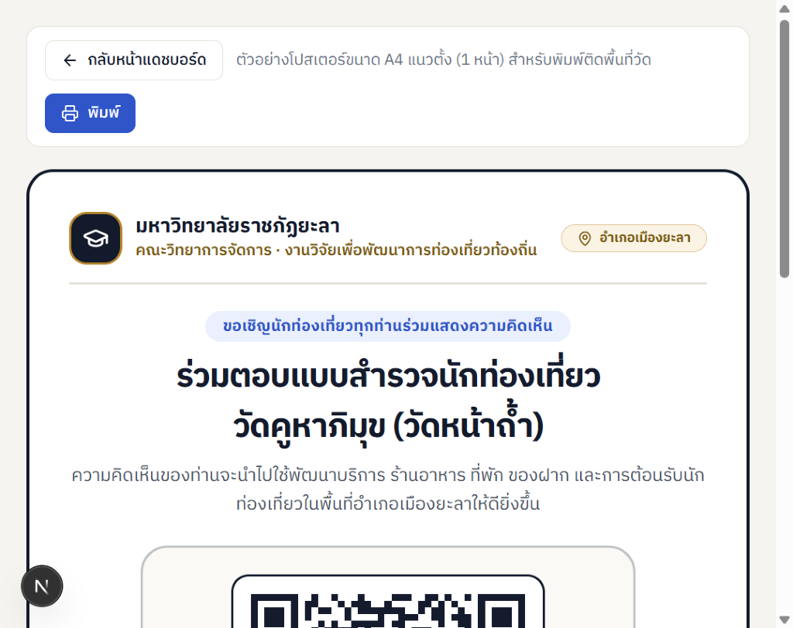

*ภาพที่ ข-2 (ข) หน้าโปสเตอร์ QR แบบสำรวจ — ภาพประกอบจากข้อมูลทดสอบ*

---

### 1.2 โครงสร้างเมนูวิเคราะห์หลัก 8 หน้า

ผู้ใช้งานสามารถเลือกเปิดดูข้อมูลตามประเด็นที่สนใจได้จากเมนูหลักทางด้านซ้าย (บนเดสก์ท็อป) หรือปุ่มเมนูทั้งหมด (บนมือถือ) โดยแต่ละหน้าออกแบบมาเพื่อตอบโจทย์การตัดสินใจทางธุรกิจที่แตกต่างกัน ดังตารางต่อไปนี้

| ลำดับ | ชื่อเมนู (เส้นทาง) | องค์ประกอบและรหัสข้ออ้างอิง | ใช้ตอบคำถามธุรกิจอะไรได้บ้าง |
|---|---|---|---|
| 1 | **ภาพรวม** (`/`) | บัตรสรุป KPI 5 ตัว (ผู้ตอบเทียบเป้าหมาย 267/300, ความพึงพอใจเฉลี่ย, % ตั้งใจกลับมาอีก, ช่วงค่าใช้จ่ายหลัก, สินค้าที่สนใจอันดับ 1), กราฟรายวัน, กราฟช่วงเวลา (เช้า/บ่าย/เย็น/อื่น), ข้อค้นพบเบื้องต้น 3 ข้อ (`SUR-01`–`SUR-10`, `submitted_at`) | ลูกค้ามาช่วงเวลาใดหนาแน่นที่สุด (เช้า 06:00–11:59 / บ่าย 12:00–15:59 / เย็น 16:00–19:59) แนวโน้มผู้ตอบแต่ละวันเป็นอย่างไร และภาพรวมกำลังซื้อหลักอยู่ที่ระดับใดภายในเวลาอ่านไม่เกิน 30 วินาที |
| 2 | **ผู้ตอบแบบสำรวจ** (`/visitors`) | กราฟแท่งแนวนอนเรียงจากมากไปน้อยของช่วงอายุและพื้นที่พำนัก พร้อมรายการคำตอบ "อื่น ๆ" (`SUR-01`, `SUR-02`) | กลุ่มลูกค้าส่วนใหญ่เป็นคนในจังหวัดยะลา 3 จังหวัดชายแดนภาคใต้ สงขลา จังหวัดอื่น หรือนักท่องเที่ยวต่างชาติ และอยู่ในช่วงวัยใด เพื่อปรับภาษาสื่อสาร เมนูอาหาร หรือลักษณะสินค้าให้ตรงกลุ่มเป้าหมาย |
| 3 | **การเดินทาง** (`/travel`) | กราฟผู้ร่วมเดินทาง, กราฟพาหนะที่ใช้ และตารางไขว้ (Heatmap) `SUR-03 × SUR-04` (`SUR-03`, `SUR-04`) | ลูกค้ามาเป็นครอบครัว คู่รัก กลุ่มเพื่อน หรือมาคนเดียว และเดินทางด้วยรถส่วนตัว รถจักรยานยนต์ หรือรถโดยสาร เพื่อใช้วางแผนพื้นที่จอดรถ ขนาดโต๊ะอาหาร/ห้องพัก และโอกาสจัดบริการรถรับ–ส่ง |
| 4 | **วัตถุประสงค์ & ช่องทางรับรู้** (`/awareness`) | กราฟแท่งแนวนอนแสดงเหตุผลการมาเยือนและช่องทางที่รู้จักสถานที่ (`SUR-05`, `SUR-06`) | ควรเลือกลงสื่อประชาสัมพันธ์หรือซื้อโฆษณาผ่านช่องทางใดก่อน (เช่น Facebook/TikTok, Google, การบอกต่อ) และควรสื่อสารจุดขายของร้านให้เชื่อมโยงกับการไหว้พระ ทำบุญ ศึกษาประวัติศาสตร์ หรือการถ่ายภาพพักผ่อน |
| 5 | **ค่าใช้จ่าย & ความสนใจ** (`/spending`) | กราฟช่วงค่าใช้จ่ายโดยประมาณ, กราฟสินค้า/บริการที่สนใจ (เลือกหลายข้อ) และตารางไขว้ `SUR-07 × SUR-08` (`SUR-07`, `SUR-08`) | นักท่องเที่ยวส่วนใหญ่ตั้งงบประมาณไว้ช่วงใด กลุ่มงบปานกลางหรือสูงสนใจสินค้า/บริการประเภทใด (เช่น อาหาร ของฝาก ที่พัก นำเที่ยว) เพื่อนำไปกำหนดระดับราคาและการจัดชุดโปรโมชันให้เหมาะสม |
| 6 | **ความพึงพอใจ & ข้อเสนอแนะ** (`/satisfaction`) | กราฟกระจายคะแนนความพึงพอใจต่อสถานที่ (1–5), ค่าเฉลี่ย/SD/ระดับแปลผล, กราฟความตั้งใจกลับมาเยือนอีก และรายการข้อเสนอแนะเปิดพร้อมช่องค้นหาคำ (`SUR-09`, `SUR-10`, `SUR-11`) | นักท่องเที่ยวประทับใจสิ่งใดและมีโอกาสกลับมาซ้ำกี่เปอร์เซ็นต์ รวมถึงเสียงสะท้อนโดยตรงจากข้อความข้อ 11 (เช่น ความสะอาด ที่จอดรถ ป้ายบอกทาง จุดบริการอาหาร/ของฝาก) เพื่อนำมาปรับปรุงจุดอ่อนของบริการในพื้นที่ |
| 7 | **มุมมองตามประเภทธุรกิจ** (`/business`) | แถบเลือก 4 กลุ่มธุรกิจ (ร้านอาหารและเครื่องดื่ม, โรงแรม/ที่พัก/โฮมสเตย์, ร้านค้า/ของฝาก, นำเที่ยว/ขนส่ง) พร้อม KPI เฉพาะกลุ่มและกฎข้อแนะนำเบื้องต้นที่มีตัวเลขหลักฐานกำกับ (`SUR-02`–`SUR-08`, `slot`) | กิจการของตนเองควรจับประเด็นใดจากข้อมูลชุดนี้ก่อน เช่น ร้านอาหารดูสัดส่วนกลุ่มครอบครัวและช่วงเวลาที่มา, ที่พักดูสัดส่วนผู้มาจากนอกจังหวัดยะลา, ร้านของฝากดูงบ ≤ 600 บาท และนำเที่ยวดูสัดส่วนผู้ใช้รถโดยสาร |
| 8 | **รายงาน & ส่งออก** (`/reports`) | ตารางแจกแจงความถี่และร้อยละครบทุกข้อ (`SUR-01`–`SUR-10`), รายการข้อเสนอแนะ `SUR-11`, ปุ่ม `ส่งออก CSV` และปุ่ม `พิมพ์ / บันทึก PDF` (`SUR-01`–`SUR-11`) | ต้องการเก็บตารางตัวเลขทั้งหมดไปเปิดวิเคราะห์ต่อในโปรแกรม Excel หรือต้องการพิมพ์สรุปเป็นเอกสารกระดาษ A4 เพื่อใช้ประกอบการประชุมผู้ประกอบการหรือแนบรายงาน |

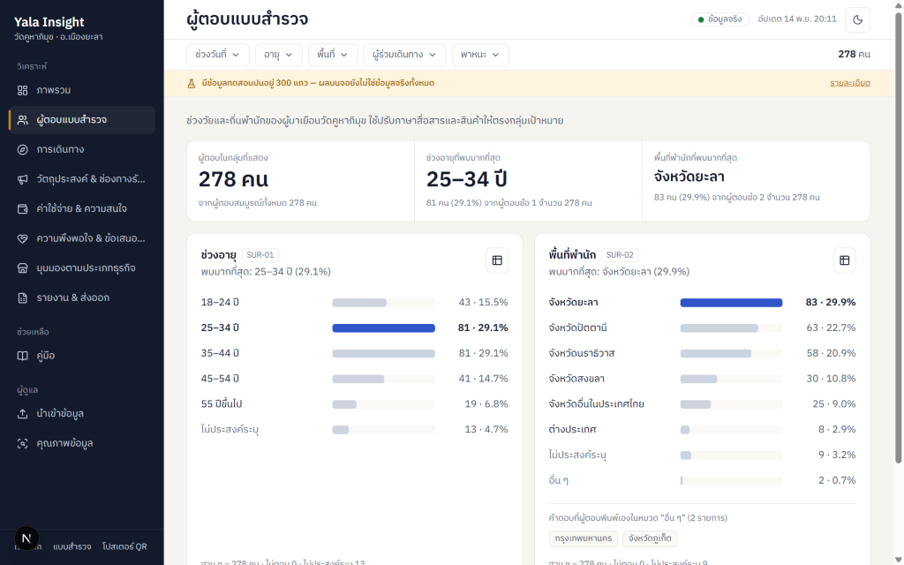

*ภาพที่ ข-3 (ก) หน้าผู้ตอบแบบสำรวจ — ภาพประกอบจากข้อมูลทดสอบ*

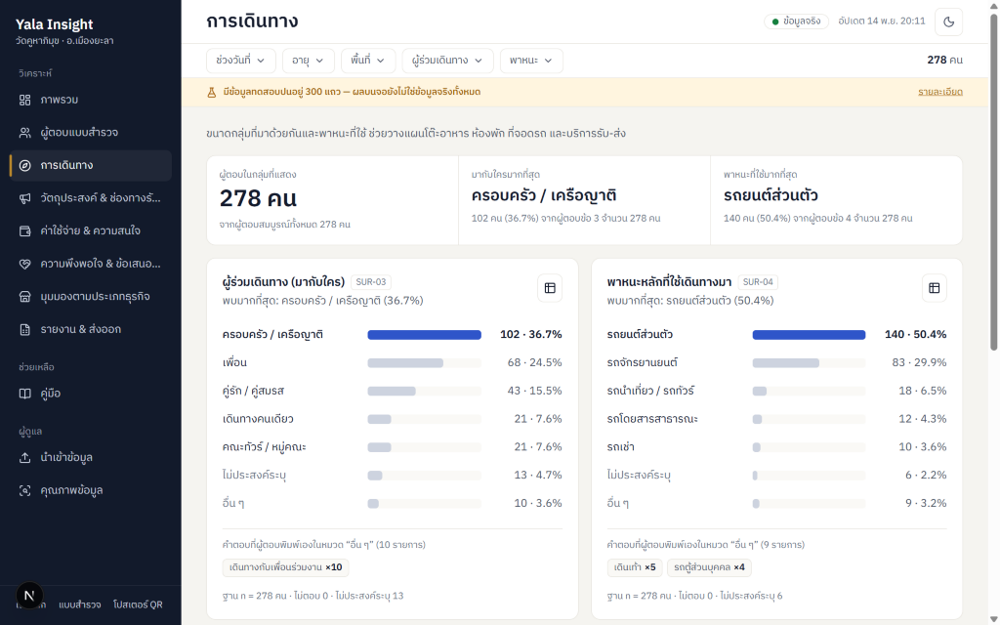

*ภาพที่ ข-3 (ข) หน้าการเดินทาง — ภาพประกอบจากข้อมูลทดสอบ*

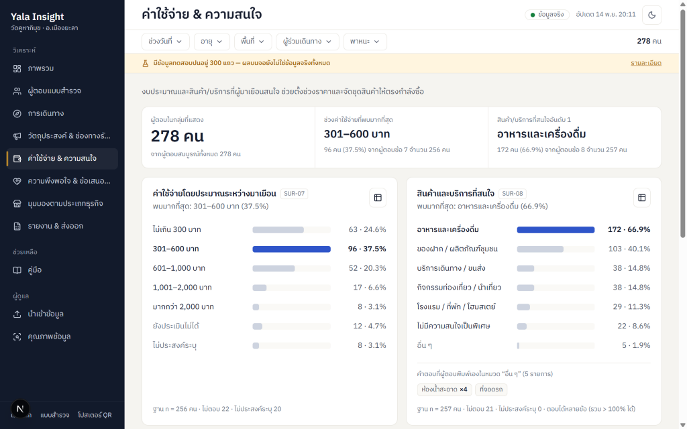

*ภาพที่ ข-4 หน้าค่าใช้จ่ายและความสนใจ — ภาพประกอบจากข้อมูลทดสอบ*

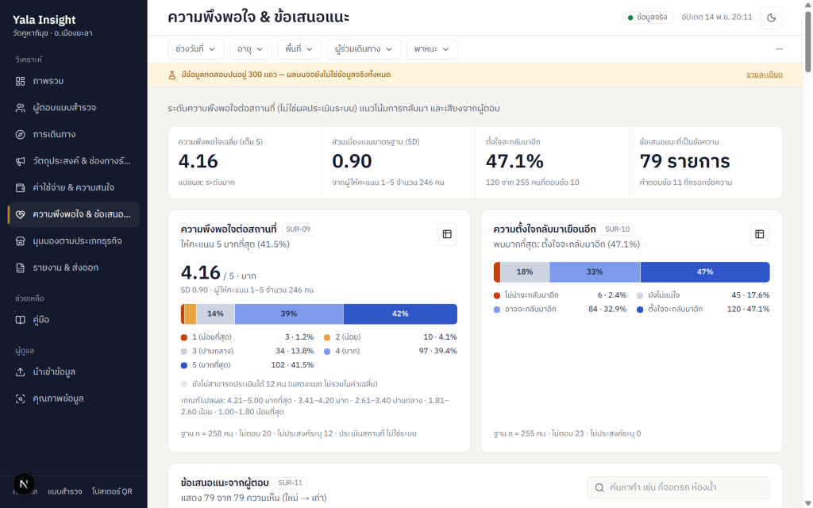

*ภาพที่ ข-5 (ก) หน้าความพึงพอใจและข้อเสนอแนะ — ภาพประกอบจากข้อมูลทดสอบ*

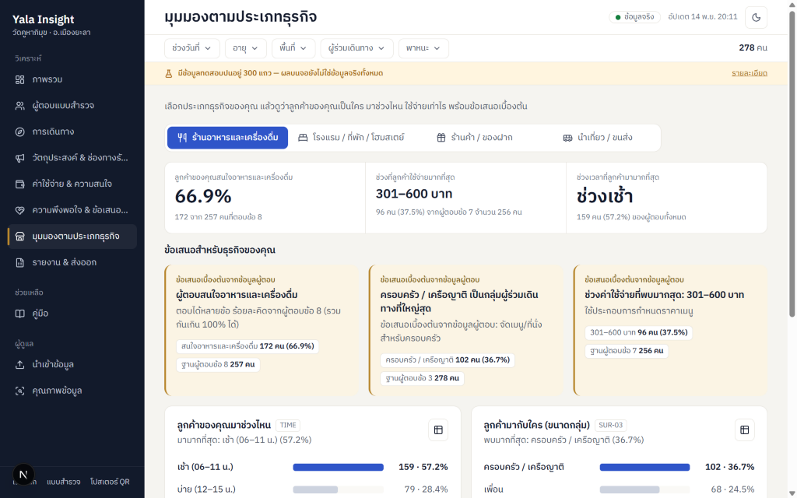

*ภาพที่ ข-5 (ข) หน้ามุมมองตามประเภทธุรกิจ — ภาพประกอบจากข้อมูลทดสอบ*

---

### 1.3 วิธีใช้แถบตัวกรองข้อมูลรวม (Global Filter Bar)

ใต้ส่วนหัวของทุกหน้าวิเคราะห์จะมี **แถบตัวกรองรวม** ติดตรึงอยู่ด้านบนของพื้นที่เนื้อหา (บนโทรศัพท์มือถือสามารถกดปุ่มเปิดลิ้นชักตัวกรองเพื่อเลือกเงื่อนไขได้อย่างสะดวก)

1. **มิติที่สามารถกรองได้ 5 มิติ:**
   - **ช่วงวันที่ (`from`, `to`):** กำหนดวันเริ่มต้นและวันสิ้นสุดตามวันที่ส่งแบบสำรวจ
   - **ช่วงอายุ (`SUR-01`):** เลือกได้มากกว่า 1 ช่วงวัย
   - **พื้นที่พำนัก (`SUR-02`):** เลือกได้มากกว่า 1 จังหวัด/ภูมิภาค (เช่น เลือกเฉพาะผู้มาจากต่างจังหวัดเพื่อเปรียบเทียบกับคนในจังหวัดยะลา)
   - **ผู้ร่วมเดินทาง (`SUR-03`):** เช่น ครอบครัว / เครือญาติ, เพื่อน, คู่รัก / คู่สมรส, เดินทางคนเดียว
   - **พาหนะ (`SUR-04`):** เช่น รถยนต์ส่วนตัว, รถจักรยานยนต์, รถโดยสารสาธารณะ
2. **การซิงก์ข้ามหน้าอัตโนมัติ:** ค่าตัวกรองทั้งหมดจะถูกบันทึกไว้ใน URL query ทำให้เมื่อสลับจากหน้า `/spending` ไปยังหน้า `/awareness` หรือ `/reports` ระบบจะยังคงเงื่อนไขตัวกรองชุดเดิมไว้โดยอัตโนมัติ และทุกตัวเลข กราฟ และตารางไขว้จะคำนวณใหม่จากกลุ่มตัวอย่างเดียวกันทันที
3. **การตรวจสอบและล้างตัวกรอง:**
   - เงื่อนไขที่กำลังใช้งานอยู่จะแสดงเป็น **ป้ายชิป (Filter Chips)** สามารถกดปิดเฉพาะตัวกรองนั้นทีละรายการ หรือกดปุ่ม **ล้างตัวกรอง** เพื่อกลับสู่ข้อมูลทั้งหมด
   - หากเงื่อนไขที่ตั้งไว้แคบเกินไปจนไม่พบคำตอบที่ตรงกัน ระบบจะแสดง **สถานะว่าง (Empty State)** พร้อมคำอธิบายเหตุผลและปุ่มสำหรับกดล้างตัวกรองได้ทันที

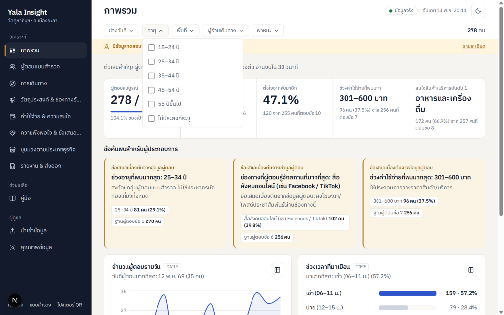

*ภาพที่ ข-6 (ก) ตัวกรองแบบ popover (เดสก์ท็อป) — ภาพประกอบจากข้อมูลทดสอบ*

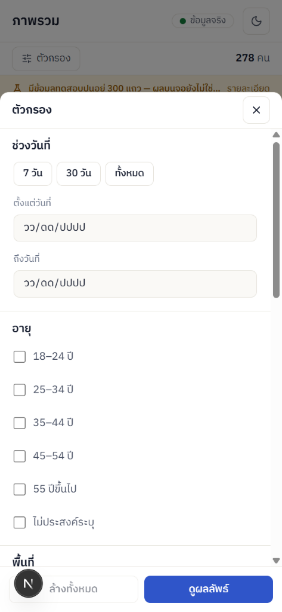

*ภาพที่ ข-6 (ข) ตัวกรองแบบแผ่นเลื่อน (มือถือ) — ภาพประกอบจากข้อมูลทดสอบ*

---

### 1.4 วิธีอ่านกราฟ ตัวเลขฐาน `n` และข้อยกเว้นทางสถิติ

เพื่อให้การตีความข้อมูลถูกต้องและไม่คลาดเคลื่อนจากความหมายทางสถิติ ผู้ใช้งานควรสังเกตองค์ประกอบต่อไปนี้ในทุกการ์ดกราฟและตาราง

1. **ความหมายของ `"ฐาน n = X คน · ไม่ตอบ Y คน · ไม่ประสงค์ระบุ Z คน"` ใต้กราฟ:**
   - **ผู้ตอบสมบูรณ์ทั้งหมดของหน้า (ฐานวิเคราะห์):** คือจำนวนแถวที่ผ่านเกณฑ์ความสมบูรณ์ (`is_complete = true` คือผ่านข้อคัดกรอง 1–2 ยินยอมให้ข้อมูล และตอบข้อบังคับ `SUR-01` ถึง `SUR-04` ครบถ้วน)
   - **ฐาน `n` (หรือ `base`) ของกราฟแต่ละข้อ:** คือ **จำนวนผู้ที่ตอบคำถามข้อนั้นจริง** ซึ่งใช้เป็นตัวหารในการคำนวณค่าร้อยละของข้อนั้น (ข้อไม่บังคับ `SUR-05`–`SUR-10` อาจมี `n` น้อยกว่าจำนวนผู้ตอบสมบูรณ์ทั้งหมดของระบบได้)
   - **ไม่ตอบ (`Y คน`):** คือผู้ที่ข้ามคำถามข้อนั้น (ค่าว่าง / `null`) **จะไม่ถูกนำมารวมเป็นตัวหาร** ของค่าร้อยละในข้อนั้น เพื่อสะท้อนสัดส่วนเฉพาะผู้ที่ให้คำตอบจริง
   - **ไม่ประสงค์ระบุ (`Z คน`):** (รวมถึงคำตอบ `"ยังประเมินไม่ได้"` ในข้อ 7 และ `"ยังไม่สามารถประเมินได้"` ในข้อ 9) คือผู้ที่ **กดเลือกคำตอบในระบบ** ไม่ใช่การข้ามข้อ จึงนับรวมอยู่ในฐานผู้ตอบ (`base`) และแสดงจำนวนแยกไว้เสมอ เพื่อให้เห็นสัดส่วนของผู้ที่ไม่สะดวกเปิดเผยข้อมูลหรือยังไม่ตัดสินใจอย่างโปร่งใส
2. **เหตุใดร้อยละของข้อ 8 (`SUR-08: สินค้าและบริการที่สนใจ`) จึงรวมกันเกิน 100% ได้:**
   - ข้อ 8 เป็นคำถามแบบ **เลือกได้หลายคำตอบ** ผู้ตอบ 1 คนอาจเลือกทั้ง "อาหารและเครื่องดื่ม" และ "ของฝาก / ผลิตภัณฑ์ชุมชน" พร้อมกัน
   - ระบบคำนวณร้อยละของแต่ละรายการโดยใช้ **จำนวนผู้ตอบข้อ 8** เป็นตัวหาร ค่าร้อยละของแต่ละแถวจึงหมายถึง *"ในกลุ่มผู้ตอบข้อ 8 มีผู้สนใจรายการนี้กี่เปอร์เซ็นต์"* ผลรวมทุกแถวจึงเกิน 100% ได้ตามธรรมชาติ และการ์ดกราฟจะแสดงป้ายกำกับเตือนไว้ชัดเจน
3. **วิธีอ่านความพึงพอใจ (`SUR-09`) และเกณฑ์แปลผล:**
   - คะแนนความพึงพอใจในระบบเป็นคะแนนประเมิน **"สถานที่วัดคูหาภิมุข"** (ไม่ใช่คะแนนประเมินตัวเว็บแอปพลิเคชันแดชบอร์ด)
   - คำตอบ `"ยังไม่สามารถประเมินได้"` จะถูกแยกแสดงจำนวนไว้ต่างหาก และ **ไม่นำมารวมคำนวณค่าเฉลี่ย (Mean) และส่วนเบี่ยงเบนมาตรฐาน (SD)** เพื่อให้ค่าเฉลี่ยสะท้อนเฉพาะคะแนน 1–5 จริง
   - เกณฑ์การแปลผลค่าเฉลี่ย (ทศนิยม 2 ตำแหน่ง): `4.21–5.00` = มากที่สุด, `3.41–4.20` = มาก, `2.61–3.40` = ปานกลาง, `1.81–2.60` = น้อย, และ `1.00–1.80` = น้อยที่สุด
4. **ป้ายแจ้งเตือนข้อควรระวังในการตีความ:**
   - **เมื่อกรองแล้วเหลือกลุ่มตัวอย่างน้อยกว่า 5 คน (`n < 5`):** ระบบจะแสดงป้ายเตือน **"จำนวนน้อย ตีความด้วยความระมัดระวัง"** เพื่อป้องกันการด่วนสรุปจากกลุ่มคนจำนวนน้อยเกินไป
   - **ป้าย `"ข้อเสนอเบื้องต้นจากข้อมูลผู้ตอบ"`:** แสดงกำกับทุกการ์ดคำแนะนำทางธุรกิจ เพื่อย้ำว่าเป็นแนวทางประกอบการตัดสินใจจากชุดข้อมูลปัจจุบัน ไม่ใช่คำสั่งบังคับ
   - **ข้อความจำกัดข้อมูลประจำทุกหน้า:** *"ผลนี้สรุปจากผู้ตอบแบบสำรวจ ณ วัดคูหาภิมุข (เลือกตัวอย่างแบบสะดวก) ไม่ใช่ยอดนักท่องเที่ยวทั้งหมด"*
5. **การสลับดูแบบตาราง:** ทุกการ์ดกราฟมีปุ่มสลับมุมมองระหว่าง **กราฟ** และ **ตารางตัวเลข** เพื่อความสะดวกในการอ่านตัวเลขที่ต้องการความแม่นยำหรือการใช้งานร่วมกับเครื่องอ่านหน้าจอ

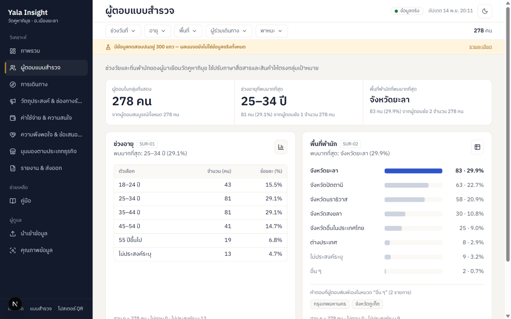

*ภาพที่ ข-7 การ์ดกราฟพร้อมฐาน n และมุมมองตาราง — ภาพประกอบจากข้อมูลทดสอบ*

---

### 1.5 การส่งออกข้อมูล CSV และพิมพ์เอกสารรายงาน (`/reports`)

1. ไปที่เมนู **รายงาน & ส่งออก** (`/reports`)
2. *(ทางเลือก)* หากต้องการรายงานเฉพาะกลุ่มเป้าหมาย เช่น เฉพาะนักท่องเที่ยวนอกจังหวัดยะลา หรือเฉพาะช่วงวันหยุด ให้ตั้งค่าในแถบตัวกรองรวมด้านบนก่อน ตัวเลขและไฟล์ที่จะส่งออกจะปรับตามตัวกรองโดยอัตโนมัติ
3. **การส่งออกไฟล์ CSV สำหรับเปิดใน Microsoft Excel:**
   - กดปุ่ม **`ส่งออก CSV`**
   - ระบบจะดาวน์โหลดไฟล์ชื่อ `yala-insight-report-all.csv` (กรณีไม่ตั้งตัวกรอง) หรือ `yala-insight-report-filtered.csv` (กรณีใช้ตัวกรอง)
   - ไฟล์เข้ารหัสแบบ **UTF-8 with BOM** ทำให้อ่านภาษาไทยใน Microsoft Excel ได้ทันทีโดยตัวอักษรไม่เพี้ยน ภายในไฟล์ประกอบด้วยข้อมูลสรุปตัวกรอง ค่า Mean/SD ความพึงพอใจ ตารางความถี่และร้อยละของ `SUR-01`–`SUR-10` และรายการข้อเสนอแนะ `SUR-11`
4. **การพิมพ์เอกสารหรือบันทึกเป็นไฟล์ PDF (ขนาด A4):**
   - กดปุ่ม **`พิมพ์ / บันทึก PDF`**
   - หน้าต่างพิมพ์ของเบราว์เซอร์จะเปิดขึ้น โดย Print CSS ของระบบจะซ่อนแถบเมนูด้านข้างและแถบตัวกรองอัตโนมัติ จัดวางหัวรายงาน ตารางผล และหมายเหตุข้อมูลให้พอดีกับกระดาษ **A4** แนวตั้ง สามารถสั่งพิมพ์ออกทางเครื่องพิมพ์หรือเลือกปลายทางเป็น `Save as PDF` ได้ทันที

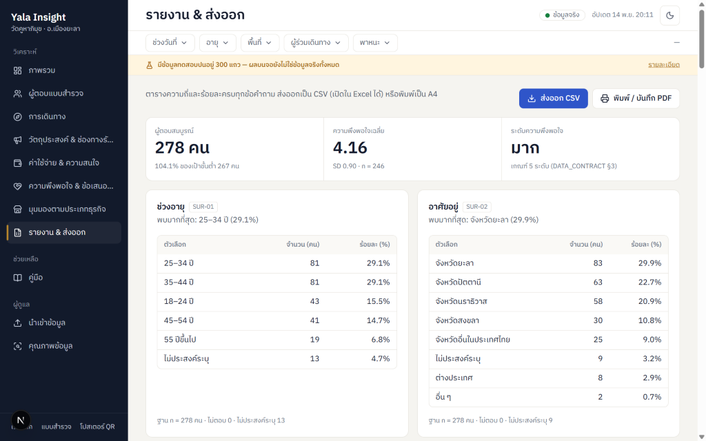

*ภาพที่ ข-8 (ก) หน้ารายงานและส่งออก — ภาพประกอบจากข้อมูลทดสอบ*


*ภาพที่ ข-8 (ข) ตัวอย่างก่อนพิมพ์ A4 — ภาพประกอบจากข้อมูลทดสอบ*

---

## ส่วนที่ 2: คู่มือสำหรับผู้ดูแลระบบ

ส่วนผู้ดูแลระบบสงวนสิทธิ์ไว้สำหรับผู้วิจัยหรือผู้ดูแลข้อมูลเท่านั้น เพื่อใช้ในการนำเข้าไฟล์สำรองจาก Google Sheets ตรวจสอบความครบถ้วนของข้อมูลดิบ รวมถึงดูแลการเชื่อมต่อฐานข้อมูล **Supabase** และสคริปต์ **Google Apps Script**

### 2.1 การเข้าสู่ระบบผู้ดูแล (`/admin/login`)

1. เปิดเบราว์เซอร์ไปยังเส้นทาง `/admin/login` (หรือคลิกลิงก์ `"พื้นที่ผู้ดูแลระบบ"` ที่ด้านล่างของแถบเมนู)
2. กรอกรหัสผ่านผู้ดูแล (`ADMIN_PASSCODE` ตามที่กำหนดไว้ใน `.env.local` หรือ Environment Variables บน Vercel) แล้วกดเข้าสู่ระบบ
   - ระบบตรวจสอบรหัสผ่านฝั่งเซิร์ฟเวอร์ด้วยแฮช `SHA-256` และออกคุกกี้ `admin_auth` (`httpOnly`) ที่มีอายุการใช้งาน **12 ชั่วโมง**
   - หากไม่ได้กำหนดค่า `ADMIN_PASSCODE` ไว้ในสภาพแวดล้อมการทำงาน ระบบจะ **ปิดการเข้าถึงหน้า `/admin/*` และ `/api/admin/*` ทั้งหมดโดยอัตโนมัติ (Fail Closed)** เพื่อความปลอดภัย
3. หากไม่เคยเข้าสู่ระบบมาก่อนแล้วเปิดหน้า `/admin/import` หรือ `/admin/quality` โดยตรง ระบบจะเปลี่ยนเส้นทางมาที่ `/admin/login` และส่วน API `/api/admin/*` จะตอบกลับรหัสสถานะ `401`
4. เมื่อใช้งานเสร็จสิ้น ให้กดปุ่ม **`ออกจากระบบ`** มุมขวาบนของหน้าผู้ดูแลเพื่อลบสถานะการยืนยันตัวตน

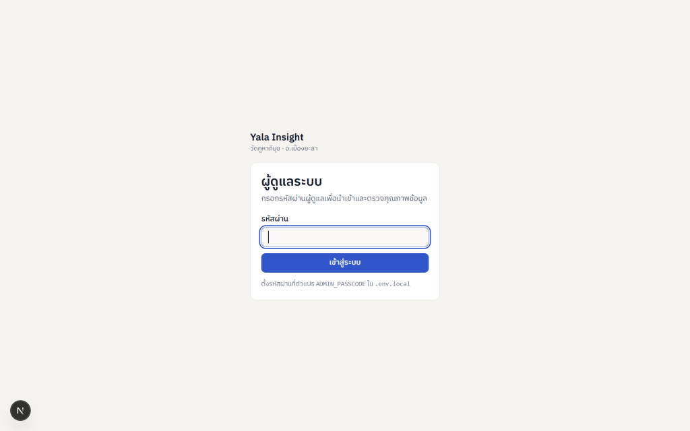

*ภาพที่ ข-9 หน้าเข้าสู่ระบบผู้ดูแล — ภาพประกอบจากข้อมูลทดสอบ*

---

### 2.2 การนำเข้าข้อมูลไฟล์ CSV จาก Google Sheets (`/admin/import`)

ใช้ในกรณีที่ต้องการนำเข้าข้อมูลย้อนหลังแบบชุดใหญ่ สำรองข้อมูลเพิ่มเติม หรือตรวจสอบความตรงกันของชุดข้อมูลจาก Google Sheets

1. **เตรียมไฟล์ CSV จาก Google Sheets:**
   - เปิดสเปรดชีตที่ผูกเก็บคำตอบของ Google Form
   - ไปที่เมนู **`ไฟล์` (File) → `ดาวน์โหลด` (Download) → `ค่าที่คั่นด้วยเครื่องหมายจุลภาค (.csv)`**
   - *(ข้อกำหนดไฟล์)* ต้องคงชื่อหัวคอลัมน์เดิมของแบบฟอร์ม (คอลัมน์เวลา `Timestamp`, ข้อคัดกรอง 1–2, คำชี้แจง, และข้อคำถาม `1.` ถึง `11.`) เพื่อให้ตัวแปลงหัวคอลัมน์อัตโนมัติจับคู่ได้อย่างถูกต้อง
2. **ตรวจสอบตัวอย่างก่อนบันทึก (Preview Mode):**
   - เปิดหน้า `/admin/import` แล้วลากไฟล์ `.csv` มาวางในกรอบอัปโหลด หรือคลิกเพื่อเลือกไฟล์จากเครื่อง
   - ระบบจะอ่านและแปลงข้อมูลทันทีโดย **ยังไม่บันทึกลงฐานข้อมูล** พร้อมแสดงสรุปจำนวนแถวทั้งหมด จำนวนแถวที่ผ่านเกณฑ์ 10 แถวแรกเป็นตัวอย่าง และแจ้งรายการบรรทัดที่มีข้อผิดพลาด (เช่น ไม่มีเวลาหรือรูปแบบวันที่/เวลาอ่านไม่ได้)
   - ทั้งนี้ ระบบจะปรับเวลาเป็นเขตไทย (`Asia/Bangkok`) รองรับปี พ.ศ. และแปลงเครื่องหมายขีดในช่วงตัวเลขเป็น en dash (`–`) ให้อัตโนมัติ
3. **ยืนยันนำเข้าลงฐานข้อมูล (Commit Mode):**
   - เมื่อตรวจสอบความถูกต้องแล้ว กดปุ่ม **`ยืนยันนำเข้า X แถว`**
   - ระบบจะเขียนข้อมูลเข้าตาราง `survey_responses` ทีละ 200 แถว โดยอ้างอิงคอลัมน์แฮช **`dedupe_key`** เพื่อข้ามแถวที่มีอยู่เดิมในฐานข้อมูลอัตโนมัติ (สามารถนำเข้าไฟล์เดิมซ้ำได้อย่างปลอดภัยโดยไม่เกิดข้อมูลซ้ำซ้อน) และบันทึกประวัติลงตาราง `import_logs`
   - หลังเสร็จสิ้น หน้าจอจะแสดงบัตรผลสรุป 3 ช่อง ได้แก่ **เพิ่มใหม่**, **ซ้ำ (ข้าม)** และ **ผิดพลาด**
   - *(กรณีโหมดเดโม่)* หากยังไม่ได้ตั้งค่า `NEXT_PUBLIC_SUPABASE_URL` และ `SUPABASE_SERVICE_ROLE_KEY` หน้าเว็บจะแสดงแถบแจ้งเตือน "โหมดเดโม่" สามารถทดลองอัปโหลดดู Preview ได้ตามปกติ แต่เมื่อกดยืนยันนำเข้า API จะคืนสถานะ `HTTP 503` พร้อมข้อความแจ้งเตือนภาษาไทยโดยไม่เขียนข้อมูล

`[ภาพที่ 10: หน้าจอนำเข้า CSV (/admin/import) แสดงตารางตัวอย่าง 10 แถวและผลสรุปการนำเข้า]`

---

### 2.3 การอ่านและตรวจสอบหน้าคุณภาพข้อมูล (`/admin/quality`)

หน้า `/admin/quality` ใช้สำหรับติดตามความสมบูรณ์ของข้อมูลดิบทั้งหมดในระบบ (รวมแถวที่ไม่ผ่านคัดกรองซึ่งไม่ถูกนำไปแสดงบนแดชบอร์ดหลัก) มีองค์ประกอบสำคัญ 5 ส่วนดังนี้

1. **แถบสถานะแหล่งข้อมูลและการซิงก์ Google Form:**
   - แสดงว่าข้อมูลกำลังอ่านจาก **ข้อมูลจริง (Supabase)** หรือ **ข้อมูลตัวอย่าง**
   - แสดงวัน–เวลาของแถวล่าสุด (`submitted_at`) พร้อมระยะเวลาที่ผ่านไป หากข้อมูลล่าสุดมีอายุ **ภายใน 24 ชั่วโมง** จะแสดงสถานะซิงก์ทำงานปกติ แต่หากเกิน 24 ชั่วโมง ระบบจะแจ้งเตือนให้ผู้ดูแลตรวจสอบ Trigger ของ Google Apps Script
2. **การ์ดตัวเลขสรุป 6 มิติ:**
   - `แบบฟอร์มทั้งหมด`: จำนวนแถวดิบทั้งหมดในฐานข้อมูล
   - `สมบูรณ์ ใช้วิเคราะห์`: แถวที่ `is_complete = true` (ตรงกับจำนวนฐานทั้งหมดในหน้าหลักแดชบอร์ด)
   - `ไม่ผ่านคัดกรอง (ข้อ 1–2)`: แถวที่ `scr01` หรือ `scr02` ไม่ใช่คำตอบ `"ใช่"`
   - `ไม่ยินยอม`: แถวที่ `con01` ไม่ใช่ `"ยินยอม"`
   - `ไม่ครบข้อบังคับ`: ผ่านคัดกรองและยินยอมแล้ว แต่ขาดคำตอบในข้อบังคับ `sur01`–`sur04`
   - `sur08 ขัดแย้ง`: จำนวนแถวที่ผู้ตอบเลือก `"ไม่มีความสนใจเป็นพิเศษ"` ร่วมกับตัวเลือกสินค้า/บริการอื่น (ระบบจะตัดตัวเลือกดังกล่าวออกในการแสดงกราฟข้อ 8 แต่คงจำนวนตรวจพบไว้ที่นี่)
3. **ตารางข้อมูลขาดรายข้อ (`sur05–sur11`):**
   - แสดงจำนวนและร้อยละของผู้ไม่ตอบ (ข้าม) ในแต่ละข้อคำถามที่ไม่บังคับ เฉพาะในกลุ่มแถวสมบูรณ์
4. **ส่วนตรวจสอบคำตอบ `"อื่น ๆ"` และข้อเสนอแนะเปิด (`sur11`):**
   - รวบรวมข้อความที่ผู้ตอบพิมพ์เองในข้อ `sur02`–`sur06` และ `sur08` ซึ่งไม่ตรงกับตัวเลือกมาตรฐาน พร้อมจำนวนความถี่ เพื่อช่วยให้ผู้วิจัยตรวจพบคำสะกดผิด หรือพิจารณาเพิ่มตัวเลือกใหม่ในอนาคต รวมถึงตัวอย่างข้อความเปิดใน `sur11`
5. **ตารางประวัติการนำเข้า (`import_logs` 20 รายการล่าสุด):**
   - แสดงเวลา ที่มา ชื่อไฟล์ จำนวนทั้งหมด เพิ่มใหม่ ซ้ำ ผิดพลาด และหมายเหตุจากทุกครั้งที่มีการนำเข้าไฟล์ CSV

`[ภาพที่ 11: หน้าจอตรวจสอบคุณภาพข้อมูล (/admin/quality) แสดง KPI 6 มิติ ตารางข้อมูลขาด และ import_logs]`

---

### 2.4 การตรวจสอบและลบข้อมูลทดสอบออกจากฐานข้อมูล (`seed:clear`)

ในขั้นตอนการพัฒนาหรือทดสอบระบบ อาจมีการเติมข้อมูลตัวอย่าง (`source = 'seed'`) เข้าสู่ตาราง `survey_responses` บน Supabase เพื่อทดลองการทำงาน ก่อนเปิดให้ผู้ประกอบการหรือผู้เชี่ยวชาญประเมินจริง ผู้ดูแลระบบต้องตรวจนับและล้างข้อมูลทดสอบออกด้วยคำสั่ง CLI (รันจากโฟลเดอร์หลักของโปรเจกต์โดยกำหนดค่า `NEXT_PUBLIC_SUPABASE_URL` และ `SUPABASE_SERVICE_ROLE_KEY` ใน `web/.env.local` ไว้แล้ว)

1. **ตรวจนับจำนวนแถวแยกตามแหล่งที่มา:**
   ```bash
   pnpm -C web seed:count
   ```
   ระบบจะพิมพ์จำนวนแถวแยกเป็น 3 แหล่ง ได้แก่ `google_form`, `csv` และ `seed`
2. **ลบข้อมูลทดสอบทั้งหมดออกอย่างปลอดภัย:**
   ```bash
   pnpm -C web seed:clear
   ```
   คำสั่งนี้จะลบ **เฉพาะแถวที่ `source = 'seed'`** เท่านั้น โดย **ไม่แตะต้องข้อมูลจริงจาก `google_form` และ `csv` แต่อย่างใด** หลังรันเสร็จระบบจะสรุปจำนวนแถว `seed` ที่ถูกลบออก
3. *(เฉพาะกรณีต้องการเติมข้อมูลทดสอบ 300 แถวกลับเข้าสู่ฐานทดลอง)* ใช้คำสั่ง `pnpm -C web seed -- --yes` (ระบบบังคับใส่ `--yes` เพื่อป้องกันการเขียนทับฐานข้อมูลจริงโดยไม่ตั้งใจ)

> **ข้อควรระวัง:** ห้ามเปิดให้ผู้เชี่ยวชาญตรวจความตรงตัวเลข (`EXP-01`–`EXP-04`) หรือเก็บผลประเมินภาคสนามขณะที่ยังมีแถว `source = 'seed'` ปะปนอยู่ในฐานข้อมูลจริง ควรรัน `pnpm -C web seed:count` ยืนยันให้ `seed = 0` ก่อนทุกครั้ง

---

### 2.5 การติดตั้ง Google Apps Script เพื่อซิงก์อัตโนมัติจาก Google Form

ระบบออกแบบให้เชื่อมต่อกับ **Google Form ฉบับเดิมที่สร้าง QR Code ใช้งานอยู่แล้ว** เพื่อไม่ให้คิวอาร์โค้ดเดิมเสียความต่อเนื่อง โดยมีขั้นตอนติดตั้งไฟล์ `script_googleForm/syncToSupabase.gs` ดังนี้

1. **เปิดหน้าแก้ไขสคริปต์จากแบบฟอร์มเดิม:**
   - เปิดไฟล์ Google Form ที่ใช้เก็บข้อมูลจริง (เข้าในสถานะผู้แก้ไขฟอร์ม)
   - กดไอคอนจุดสามจุด (`⋮`) ที่มุมขวาบน → เลือก **`โปรแกรมแก้ไขสคริปต์` (Script editor)**
   - ลบโค้ดตัวอย่างเดิมออก แล้ววางโค้ดทั้งหมดจากไฟล์ `script_googleForm/syncToSupabase.gs` และกดบันทึก (`Ctrl + S`)
   - **คำเตือนสำคัญ:** อย่านำสคริปต์สร้างฟอร์มใหม่ (เช่น `createYalaTouristSurveyForm()`) มารันซ้ำกับฟอร์มจริง เพราะจะทำให้ได้ฟอร์มใหม่ที่มีลิงก์และ QR Code เปลี่ยนไปจากโปสเตอร์เดิม
2. **กำหนดค่า Script Properties สำหรับเชื่อมต่อ Supabase:**
   - ในหน้า Apps Script ไปที่เมนูด้านซ้ายรูปเฟือง **`การตั้งค่าโปรเจกต์` (Project Settings)**
   - เลื่อนลงไปที่หัวข้อ **`คุณสมบัติของสคริปต์` (Script properties)** กด **`เพิ่มคุณสมบัติของสคริปต์`** แล้วใส่ค่า 2 รายการให้ตรงตามตัวสะกดดังนี้
     - `SUPABASE_URL` : URL ของโปรเจกต์ Supabase (เช่น `https://xxxx.supabase.co` ไม่ต้องมี `/` ปิดท้าย)
     - `SUPABASE_SERVICE_KEY` : ค่า `service_role` key จากหน้า API Settings ของ Supabase
   - กดบันทึกคุณสมบัติสคริปต์
3. **ติดตั้งตัวกระตุ้นอัตโนมัติ (`installTrigger`):**
   - กลับไปที่หน้าตัวแก้ไขโค้ด (`Editor`)
   - ที่แถบเครื่องมือด้านบน เลือกฟังก์ชัน **`installTrigger`** แล้วกด **`เรียกใช้` (Run)** จำนวน 1 ครั้ง
   - เมื่อ Google แสดงหน้าต่างขออนุญาตสิทธิ์ ให้กดตรวจสอบสิทธิ์และอนุญาต (Authorize) เพื่อให้สคริปต์อ่านคำตอบฟอร์มและส่ง HTTP Request ไปยัง Supabase ได้
   - ฟังก์ชันนี้จะลบ trigger ซ้ำของเดิม (ถ้ามี) และผูกเหตุการณ์ `onFormSubmitSync` ให้ส่งคำตอบใหม่เข้า Supabase ทันทีที่นักท่องเที่ยวกดส่งแบบฟอร์มทุกครั้ง
4. **ส่งคำตอบเก่าที่มีอยู่แล้วทั้งหมดย้อนหลัง (`backfillAll`):**
   - ที่แถบเลือกฟังก์ชันด้านบน เปลี่ยนเป็น **`backfillAll`** แล้วกด **`เรียกใช้` (Run)** จำนวน 1 ครั้ง
   - สคริปต์จะดึงคำตอบย้อนหลังทั้งหมดมาจัดรูปแบบและส่งเข้า Supabase ทีละ 200 แถว พร้อมแสดงข้อความในบันทึกการทำงาน (`Execution log`) ว่า `ส่งแล้ว X แถว`
   - สามารถรัน `backfillAll()` ซ้ำได้โดยไม่เกิดข้อมูลซ้ำซ้อน เนื่องจาก API ใช้เงื่อนไข `on_conflict=dedupe_key` และ `Prefer: resolution=ignore-duplicates`
5. **ตรวจสอบผลหลังติดตั้ง:**
   - ลองเปิดหน้า `/admin/quality` แล้วตรวจแถบสถานะการซิงก์และตัวเลข `แบบฟอร์มทั้งหมด` ว่าตรงกับยอดใน Google Form และ Google Sheets หรือไม่ (ดูวิธีตรวจนับมือด้วยสูตร `COUNTIFS` ใน `docs/QA_CHECKLIST.md`)

`[ภาพที่ 12: หน้าจอ Google Apps Script แสดงการตั้งค่า Script properties และผล Execution log หลังรัน backfillAll]`
